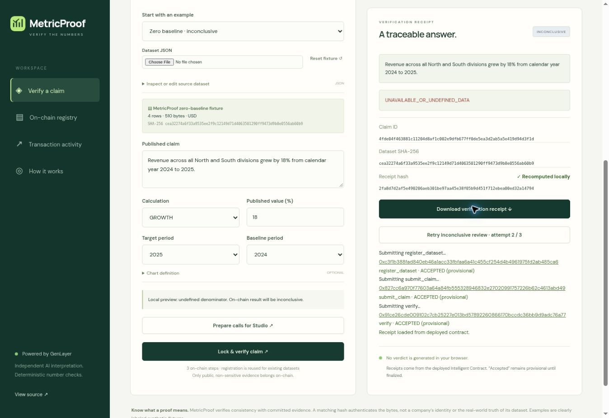

# MetricProof verification report

Verified on 29 October 2026 against Studionet (chain 61999).

## Automated checks

- GenVM lint and SDK semantic validation passed for MetricProof: 3 writes and 5 views.
- 33 direct contract tests cover arithmetic, negative growth, rounding ties, all verdict branches, malformed input, source integrity, independent validator rejection, submitter permissions, retry limits and append-only receipts. AI and web responses in these tests are mocked.
- 15 frontend lifecycle tests include real captured finalized consensus disagreement, execution failure, missing consensus outcomes, exact large-integer serialization, fixed-point parsing and canonical hashes.
- 9 receipt tests validate captured live bundles and reject altered source bytes, claims, results and chain bindings.
- Production Vite build passed.

These checks do not turn mocked model outputs into live consensus evidence.

## Live checks already verified

| Path | Case ID | Result |
|---|---|---|
| Studio built-in account, inline dataset | `963bdcc5649bcec4040bde3a166ef82871375175e5e11f773484f3a117a28eb0` | INCORRECT, finalized successful review |
| Website, byte-exact linked dataset, 45% claim | `293c5d7c0090e1dd6ecbb220e626fb0fbc7271af10f63bf414add3a8195a0876` | INCORRECT, finalized successful review |
| Website, correct 18% claim | `05d35b170fd413e5307f901ac88034fdda935c6e7e71cd12863b72a2bf4a7c4d` | ACCURATE, finalized successful review |
| Website, correct number plus truncated bar | `16fec4db26703dacb0fc55bc68f9a98480752916679bb905e6e9a8dcb5287bae` | MISLEADING, finalized successful review |
| Website, zero baseline | `4fde04f463881c11204d8af1c002e9dfb677ff0de5ea3d2ab5a5e419d94d3f1d` | INCONCLUSIVE, finalized successful review |

The independent source check matches the deployed contract code to SHA-256 `030eeb92416cc56a522cbf4b5fb49031a28f928b37b2e20cf196ea5fed31aa6e`.

A live ambiguous claim (`Performance improved by 18%.`) produced validator disagreement: transaction `0xaadbdef5cb34fd19a1bf9e3e36dc2df41aa0d210aba1afefefcfad3b0747d9a0`. Its leader executed, but consensus rejected the result. No positive certificate is claimed. The captured transaction is a regression fixture ensuring finalization cannot erase consensus failure in the UI.

## UI and wallet boundaries

Deployment, dataset registration, claim submission and review were exercised with Studio's built-in account. Direct website account creation and sequential writes were also exercised, with dataset reuse, pending/accepted states, failures and receipt rendering. Studio's wallet is not directly connectable across origins; the website offers a signing handoff and a separately labeled in-memory test account.

Screenshots document desktop browser checks. Responsive CSS is included; do not interpret desktop screenshots as exhaustive mobile-device testing. No mainnet, funded-wallet, PDF parsing, chart-image inspection, real issuer authentication or adoption claims are made.

An additional live source-mismatch transaction was not executed after automatic approval review rejected it because the full payload was not visible. That negative path is covered by deterministic mocked tests; positive live linked-source retrieval was verified.

Receipt download emitted a browser download event, but the automation returned an inaccessible file path. The app also provides a clipboard JSON export for independently checking the exact exported receipt. RPC-captured bundles are checked by the offline verifier.

